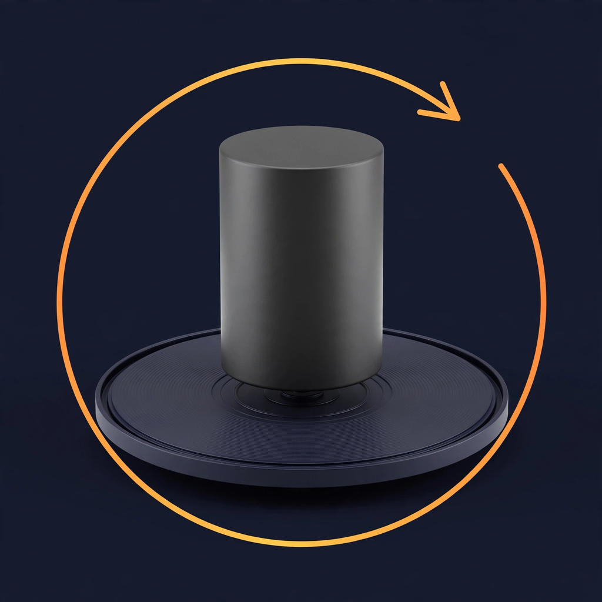

# VV Capture

> VisionVend fork of [ObjectScanner](https://github.com/buraksahinkaya/objectscanner)
> (Apache-2.0), stripped to a single purpose: turntable product capture for
> VisionVend SKU onboarding. The iPhone stays fixed, the product rotates;
> every shot gets a yaw entry in `yaw.jsonl` for the downstream pipeline
> (label panorama → OCR, multi-view gallery, YOLO training data, Gaussian splat).

<p align="center">
  
</p>

<h1 align="center">VV Capture</h1>

An iOS app for 3D-capturing products on a motorized turntable. One capture
mode, one output contract: a folder of stills plus a `yaw.jsonl` sidecar that
records each shot's rotation angle, so the downstream pipeline can treat a
360° product rotation as a virtual camera orbit.

The reference rig is a fixed **iPhone 15 Pro Max** and an adjustable-speed
electronic turntable. The phone never moves, which is exactly why this is a
custom `AVFoundation` capture engine and not Apple's guided
`ObjectCaptureSession` — the guided flow is built on ARKit world tracking, so
a stationary device reads as "never moved" and the bounding box drifts off a
turning object. `PhotogrammetrySession` has no such dependency: it solves
poses from the images themselves.

---

## How a capture works

1. **Setup guide** (shown once) — frame the product, set the turntable speed.
2. **Capture** — the engine fires the shutter on a timer derived from the
   turntable RPM, so shots land at even angular intervals.
3. **Per shot**, the engine records:
   - **AE/AF/AWB lock.** Left on automatic, focus breathing shifts the
     intrinsics between frames and the solve degrades.
   - **Blur rejection.** Each frame is scored on gradient energy; anything
     below the floor is deleted and reshot.
   - **Maximum still resolution** from `supportedMaxPhotoDimensions`, with
     LiDAR depth embedded in every HEIC so metric scale survives to the Mac.
   - **Object mask.** An optional drag rectangle; only its interior is
     modelled. Possible only because the device does not move, so one
     rectangle covers every frame.
   - **A `yaw.jsonl` entry** — shot index, file name, timestamp, sharpness
     score, and the yaw angle once known (see below).
4. **Reconstruction** — on-device `PhotogrammetrySession` produces a `.reduced`
   preview model. The source images are kept for the full-detail Mac path.

### `yaw.jsonl`

One JSON object per line, written as shots land, at the workspace root:

```json
{"shot":1,"file":"shot_0001.heic","timestamp":"2026-10-16T06:25:01Z","thetaDeg":null,"method":"timestamp","sharpness":0.83}
```

- `thetaDeg` — yaw in degrees, clockwise looking down at the turntable. `null`
  until the yaw estimator fills it in.
- `method` — how the angle was produced: `timestamp` (estimator pending),
  `marker` (ArUco on the turntable edge), `vision` (angular velocity from the
  image stream), `rpm` (timestamp × calibrated turntable RPM).
- `sharpness` — gradient-energy score from capture, when measured.

Until the marker estimator lands, every entry carries the capture timestamp,
so `thetaDeg` backfills as `ω·Δt` once the turntable RPM is known — which is
exactly what the panorama builder and the splat stage need to place each
frame.

---

## Requirements

| | |
|---|---|
| Device | iPhone with LiDAR (iPhone 12 Pro or later; reference rig is iPhone 15 Pro Max) |
| iOS | 18.0 or later |
| Xcode | 16 or later |
| Mac | Any Apple silicon Mac, for the optional full-detail reconstruction |

The simulator is not useful: capture needs a real camera and LiDAR, and the
app checks for it at runtime rather than guessing from a device list.

## Getting it running

```bash
git clone https://github.com/Data-based-eng/vv-capture.git
cd vv-capture
open VVCapture.xcodeproj
```

Then, in Xcode:

1. Select the **VVCapture** target → **Signing & Capabilities**.
2. Set **Team** to your own Apple ID team (the repo carries VisionVend's).
3. Plug in the device, select it, and press ⌘R.

A free Apple ID works. First launch on the device needs Developer Mode:
**Settings → Privacy & Security → Developer Mode**.

The project uses `PBXFileSystemSynchronizedRootGroup`, so files added under
`VVCapture/` are picked up automatically — no need to touch the project file.

---

## What actually determines quality

Measured on device, not inferred. The full write-up, including how to
reproduce each measurement, is in
**[docs/what-limits-quality.md](docs/what-limits-quality.md)**.

### Surface appearance decides the technique

| Object surface | Photogrammetry |
|---|---|
| Textured, matte | Best geometry |
| Flat single colour | Softens, detail lost |
| Matte black | Fine |
| Glossy / metallic | Poor |

In photogrammetry, **texture is an input, not an output.** Visual pattern on
the surface is the only source of frame-to-frame correspondence and therefore
of geometry. A featureless object starves it no matter how good the light or
how many photos you take.

### The iOS detail ceiling is the dominant limit

`PhotogrammetrySession.Request.Detail` declares **only `.reduced` on iOS**.
`.medium`, `.full` and `.raw` exist on macOS only — verified in the iOS 26.5
and 27.0 SDKs, not from documentation:

```
$ grep -A6 "public enum Detail" RealityFoundation.swiftinterface
public enum Detail : Swift::Int, Swift::Hashable {
  case reduced
  ...
```

`reduced` is a fixed budget per model: roughly 25,000 triangles and a single
texture. So on-device reconstruction is a preview. The real output comes from
the Mac, which is why the app keeps the source images and offers a one-tap
zip export.

### Capture geometry is measurable

`PhotogrammetrySession.Request.poses` (iOS 17+) reports the solved camera
transforms. It rides along on alignment work the session already does, so it
is nearly free — and it turns "the quality is bad" into three numbers:

- **alignment ratio** — how many frames the solver actually placed
- **azimuth coverage** — how much of a full turn the cameras cover
- **elevation spread** — the difference between the highest and lowest camera

Each maps to a distinct failure with a distinct fix, and the app says which
one applies. For a turntable capture, azimuth coverage should read a full
360° — anything less means the RPM timing or the shot count is off.

---

## Architecture

```
ScanEngine (protocol)            Core/ScanEngine.swift
  └── TurntableCaptureEngine     fixed phone, rotating product
            ↓
      ScanRecord                 Core/ScanRecord.swift
            ↓
  ModelPreviewView · MeshExporter · ScanStorage
```

```
VVCapture/
├── Core/
│   ├── ScanEngine.swift          Protocol, ScanPhase, EngineAvailability, errors
│   ├── ScanEngineKind.swift      Mode identity
│   ├── ScanRecord.swift          Persisted record + ReconstructionDetail
│   ├── DeviceCapabilities.swift  Runtime capability queries
│   ├── ReconstructionProgress.swift
│   └── ScanStorage.swift         Disk layout, library JSON, workspaces
├── Engines/Turntable/
│   ├── TurntableCaptureEngine.swift   Fixed phone, rotating object, RPM timing
│   ├── PhotoCaptureCoordinator.swift Focus lock, max resolution, blur rejection
│   ├── SharpnessMeter.swift          Gradient-energy frame scoring
│   ├── ObjectMaskBuilder.swift       Rectangle → objectMask
│   ├── MaskedSampleSequence.swift    Lazy PhotogrammetrySample stream
│   └── YawManifest.swift             Per-shot yaw.jsonl sidecar
├── Engines/Photogrammetry/
│   ├── PhotogrammetryReconstructor.swift Images → USDZ
│   └── PoseDiagnostics.swift             Solved poses → three numbers
├── Export/
│   ├── MeshExporter.swift        USDZ / OBJ / PLY / STL (ModelIO)
│   └── SourceImageBundle.swift   Zip for the Mac full-detail path
└── Features/                    SwiftUI screens (Root, Capture, Preview)
```

### Design decisions

**Capability detection at runtime.** `PhotogrammetrySession.isSupported`,
`AVCaptureDevice.default(...)`. No device-model list — those break with every
hardware generation and on the simulator.

**Records store a relative file name, not a URL.** The app container path
changes between installs, so absolute URLs go stale and every model in the
library silently disappears. `ScanStorage` resolves the real URL.

**Source images are kept after reconstruction.** They are the largest thing
on disk and the only route to full detail, so deleting them is an explicit
user action.

**Rotation is data, not UI.** The turntable angle is written into `yaw.jsonl`
at capture time rather than derived later, so the downstream pipeline
(panorama, gallery, splat) never has to guess which frame is which.

---

## Mac-side tools

Small `swiftc`-compiled command line tools. They exist because of a hard
platform split, not as conveniences.

### Tools/Reconstruct.swift

Full-detail reconstruction from an image folder.

```bash
swiftc -O -parse-as-library Tools/Reconstruct.swift -o /tmp/reconstruct
/tmp/reconstruct ~/Downloads/frames ~/Desktop/model.usdz raw
```

Detail levels: `preview | reduced | medium | full | raw`. Reports depth
availability, stage names, percentage and checkpoints as it runs.

### Tools/MeshStats.swift

Vertices and triangles via ModelIO, real bounding box via SceneKit. The
measurements in this README came from here.

```bash
swiftc -O -parse-as-library Tools/MeshStats.swift -o /tmp/meshstats
/tmp/meshstats model-a.usdz model-b.usdz
```

### Tools/RenderViews.swift

Renders a model from four angles to PNG, offscreen. Evaluating a scan means
*looking* at it, and the alternatives do not work: `qlmanage` stalls on a
36 MB USDZ and `SCNView.snapshot()` wants a window. `SCNRenderer` on a Metal
device needs neither.

```bash
swiftc -O -parse-as-library Tools/RenderViews.swift -o /tmp/renderviews
/tmp/renderviews model.usdz output 1100
```

Lighting is ambient only on purpose: a directional light carves its own
shadows, and those must not be mistaken for the model's real surface detail.

---

## SDK notes

Verified against `.swiftinterface` files and framework headers rather than
documentation. Each of these cost real debugging time.

- `PhotogrammetrySession.Request.Detail` declares **only `.reduced` on iOS**
  — `.medium`, `.full`, `.raw` are macOS-only. Verified in the iOS 26.5 and
  27.0 SDKs.
- `PhotogrammetrySession.Configuration` has **no quality dial beyond**
  `isObjectMaskingEnabled`, `sampleOrdering`, `featureSensitivity`,
  `checkpointDirectory` and `ignoreBoundingBox`. Poor quality is a capture
  problem, not a settings problem.
- With two requests in flight, **filter progress by request** or the bar jumps
  backwards — and a failing `.poses` request must not cost the user their
  model.
- **`AVDepthData` has no confidence map.** Filtering has to fall back to NaN
  checks, range limits and depth-gradient rejection for flying pixels.
- `@main` with top-level code needs `swiftc -parse-as-library`.

## Building from the command line

```bash
xcodebuild -project VVCapture.xcodeproj -scheme VVCapture \
  -destination 'generic/platform=iOS' -configuration Debug \
  build CODE_SIGNING_ALLOWED=NO
```

The project builds with **zero warnings** under the Swift 6 language mode.
Where concurrency required an escape hatch it is `@unchecked Sendable` with a
comment naming the queue or actor that confines the type — never
`@preconcurrency` to silence a diagnostic.

## Known limitations

- Turntable results vary with lighting. Rotating the object slides shading
  across its surface, which is a structural disadvantage the mode cannot
  fully overcome.
- `thetaDeg` in `yaw.jsonl` is `null` until the ArUco marker estimator lands;
  backfill is timestamp × calibrated RPM.
- On-device reconstruction is `.reduced` (~25,000 triangles) — a preview. Full
  detail needs the Mac path above.
- Orphaned workspace folders are not garbage-collected if the app is killed
  mid-scan.

## Licence and attribution

**Apache License 2.0** — see [LICENSE](LICENSE).

Use it commercially, modify it, ship it. One thing is asked in return, and the
licence makes it a requirement rather than a favour: **credit it.** Section
4(d) of Apache-2.0 obliges derivative works to carry the contents of the
[NOTICE](NOTICE) file, so the requested form is one line:

> This product includes software developed by Burak Sahinkaya
> (ObjectScanner — https://github.com/burakSahinkaya/ObjectScanner).

An "Open source licences", "Acknowledgements" or "Third-party software"
screen is the usual place for it. Documentation works too.

This covers the code and equally the approaches written up above — the
object-mask turntable capture and the pose-diagnostic reporting.

Apache-2.0 rather than MIT specifically for this: MIT also requires its
notice to be retained, but Apache-2.0 has `NOTICE` as a defined mechanism for
carrying attribution into a shipped product, and adds an explicit patent
grant.
